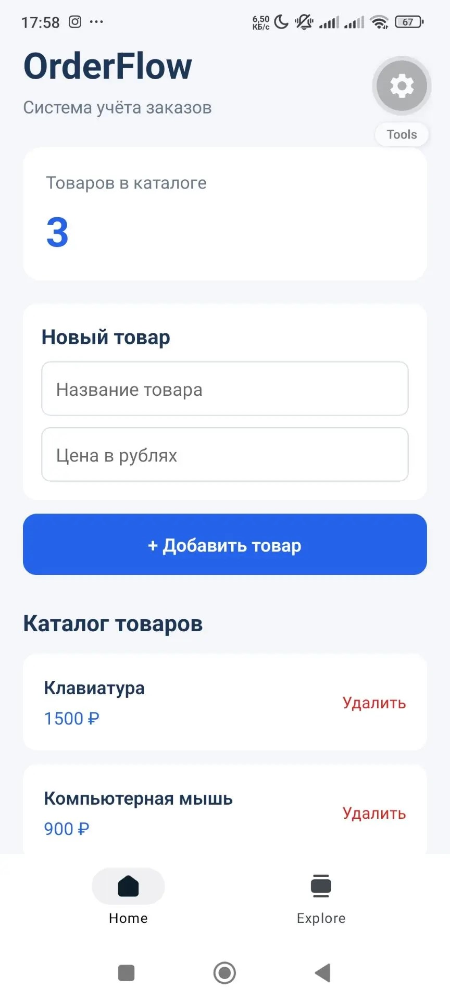

# OrderFlow — учёт заказов

Учебный проект по дисциплине **«Разработка кроссплатформенных мобильных приложений»**. Вариант № 15 — «Информационная подсистема учёта заказов».

**Выполнил:** Чурин Роман Владимирович, ИСТZ-3401, 4 курс.

## О проекте

OrderFlow — мобильное приложение для учёта товаров и заказов небольшого магазина. В нём можно добавлять и редактировать товары, распределять их по категориям, следить за остатками, искать нужные позиции и оформлять заказы. При оформлении учитываются количество товаров и скидка, автоматически рассчитывается сумма и уменьшаются остатки на складе. Оформленные заказы сохраняются в истории; для них предусмотрен статус отгрузки.

Клиентская часть написана на **React Native с Expo и TypeScript**. Она обменивается данными с сервером на **Node.js и Express** через REST API. В **PostgreSQL** хранятся категории, товары, заказы и их состав. Сервер проверяет входные данные, а оформление заказа проводит в одной транзакции, чтобы записи о покупке и изменение остатков выполнялись согласованно. Денежные суммы в базе хранятся в копейках.

Проект разрабатывался и проверялся на **Windows и Android** с использованием Expo Go. Мобильная часть использует кроссплатформенный стек, однако отдельное тестирование на iOS не проводилось.

## Скриншоты приложения

На скриншотах показано, как менялся интерфейс OrderFlow в процессе разработки, и работа текущей версии с PostgreSQL.

**Подключение к PostgreSQL, каталог товаров и история заказов**

**Этапы разработки интерфейса**

  
  
  
  

